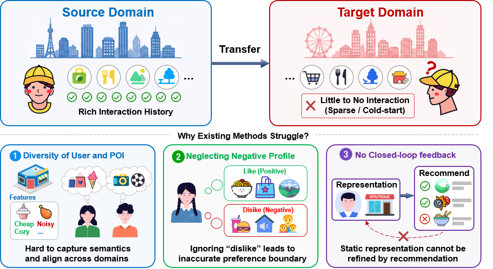
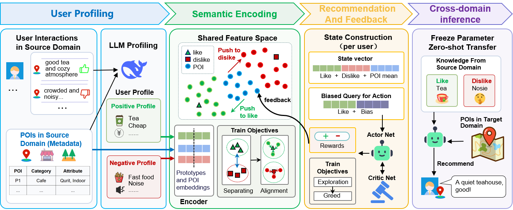

# DPFR

**Dual-Prototype Transfer with Feedback Refinement for POI Recommendation**

DPFR extracts positive/negative source-user profiles, learns shared POI and prototype representations, and refines them through recommendation feedback. It exports user prototypes and recommendations over externally retrieved candidates.

---


## Introduction
Here we provide the overall intuition and performance comparison of our proposed method.

<p align="center">
  
</p>

---


## Methodology & Framework

<p align="center">
  
</p>

---


## Setup

Python 3.10+ and PyTorch are required. Install the appropriate CPU/CUDA build of PyTorch for your machine, then run:

```bash
python -m pip install -r requirements.txt
```

## Code

| File | Implementation |
|---|---|
| `EncoderRL.py` | Tokenization, shared Transformer, projection, three encoder losses and feedback updates |
| `AgentRL.py` | Actor/Critic networks, residual queries, rollout collection, GAE and PPO |
| `EnvironmentRL.py` | Data loading, source candidate sampling, states, action masks and rating-based rewards |
| `Train.py` | Encoder initialization, joint training, checkpoints, prototype export and frozen inference |
| `EmotionParser.py` | English prompts, API requests, JSON parsing and source-profile caching |
| `Config.py` | Parameters, path handling, validation and checkpoint/file utilities |

## Data

Download [Yelp](https://business.yelp.com/data/resources/open-dataset/) or [Google Local](https://mcauleylab.ucsd.edu/public_datasets/gdrive/googlelocal/) under their dataset terms. Prepare one transfer direction and put these UTF-8 files in `data/`:

**`poi_metadata.json`** - source and target POIs; preserve attribute values and deduplicate features.
```json
{
  "s1": {"domain": "Philadelphia", "features": ["Cafe", "WiFi=free"]},
  "t1": {"domain": "New Orleans", "features": ["Cafe", "WiFi=free"]}
}
```

**`source_users.jsonl`** - one source history per line, in chronological order; retain original ratings and reviews.
```json
{"user_id":"u1","source_records":[{"poi_id":"s1","rating":4.5,"review":"I liked the free WiFi."}]}
```

**`profiles.jsonl`** - cached source profiles, one user per line. Generate it with `EmotionParser.py` only when needed.
```json
{"user_id":"u1","global_liked":["Cafe","WiFi=free"],"global_disliked":[]}
```

**`candidates.json`** - output of any external retriever, before DPFR selection.
```json
{"u1":["t1","t2","t3"]}
```

The snippets illustrate schemas, not a demo dataset. Every candidate needs metadata and a user with source prototypes. Keep IDs as strings and target histories/ratings out of model inputs. Legacy `business_id`/`gmap_id`, `stars`, `text`, and `categories`/`attributes` fields are accepted. No retriever is bundled.

## Run

Edit `config.json`: data paths, source/target domains and output directory. Relative paths resolve from the config file; absolute paths are also accepted. Hyperparameters are centralized there. Use separate profiles and output directories for reverse transfer directions.

```bash
python Train.py --config config.json --check
python Train.py --config config.json
python Train.py --config config.json --mode predict
```

Resume training with `--resume outputs/yelp_p_n/training_state.pt`. Prediction loads `model.pt`, target metadata and candidates; it does not require source histories or profile files. Candidates are deduplicated, and short lists return only the available POIs.

### Optional profile extraction

Set `profiling.base_url` and `profiling.model` to your API endpoint and exact model ID. The English system and user prompts are directly in `EmotionParser.py`. Set the key through an environment variable, for example in PowerShell:

```powershell
$env:DEEPSEEK_API_KEY = "YOUR_API_KEY"
python EmotionParser.py --config config.json --allow-api
```

Existing profiles are reused. Training never calls an API. To inspect the actual input without sending a request, use `--preview outputs/prompt.json` instead of `--allow-api`.

## Outputs

The configured output directory contains `model.pt`, `prototypes.jsonl` (each user's `positive_prototype` and `negative_prototype`), and `recommendations.json` (`user_id` to `recommended_pois`). Training also saves a resume checkpoint and a lightweight log. No evaluation, plotting or experiment runners are included.
