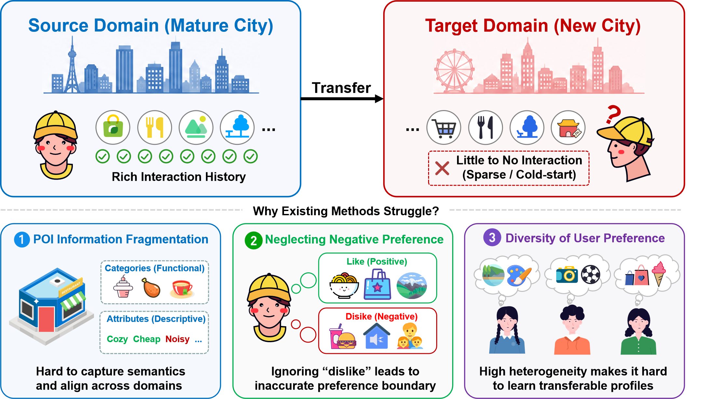
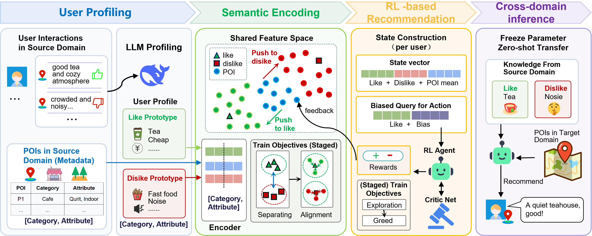

# Dual_RL_Rec

This is the repository for the paper: **"Bridging the Domain Gap: POI Recommendation via Dual-Prototype Semantic Alignment and Reinforcement Learning"**.

---

## 📌 1. Introduction
Here we provide the overall intuition and performance comparison of our proposed method.

<p align="center">
  
</p>

---

## ⚙️ 2. Methodology & Framework

<p align="center">
  
</p>

---

## 📝 3. User Profiling Prompts
As specified in the paper, we leverage Large Language Models (LLMs) to perform semantic data augmentation and extract fine-grained user profiles from review data. 

Below is the complete **System Prompt** and **User Prompt** structure used for user preference extraction:

### System Prompt
"""You are a rigorous data analysis expert for recommendation systems. Please extract the user profile and score each POI based on the user's minimalist check-in records. Note: Records containing 'Cat' and 'Attr' represent POI samples, while those with 'Rev' represent user review samples.

    Please strictly output the following JSON format (do not output Markdown markers like ```json, just output the curly braces):

{
"global_liked": {"categories": ["sub-category 1"], "attributes": {"attribute_key": "value"}},
"global_disliked": {"categories": ["sub-category 2"], "attributes": {"attribute_key": "value"}},
"poi_scores": {"1": 4.5, "2": 3.0}
}

[Ensure the output adheres strictly to the following principles]:
1. Principle of Category Mutually Exclusive: The categories in global_liked and global_disliked must NEVER overlap. If similar categories exist, they must be subdivided with specific modifiers (e.g., liked: ["Luxury Hotel"], disliked: ["Noisy Motel"]).
2. Principle of Objective Environment: The attributes must be specific, objective physical or facility characteristics (e.g., "WiFi": "free").
3. Principle of Short-ID Scoring: The keys in poi_scores MUST be the minimalist pure numeric IDs read from the input (e.g., "1", "2", "3"). You must provide a comprehensive score ranging from 1.0 to 5.0 for all numeric IDs present in the input, based on the user's sentiment explicitly expressed in the reviews."""

### User Prompt
   user_prompt = f"User Records: \n{compressed_text}"
